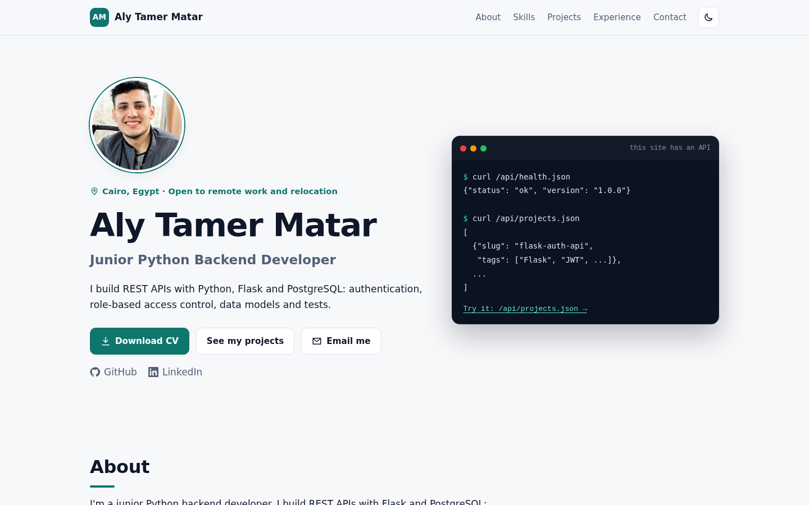
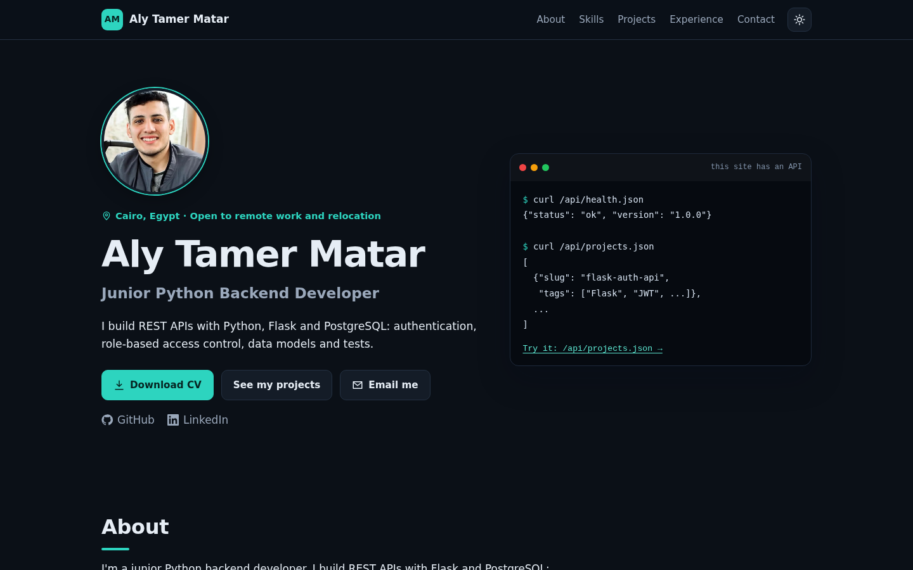
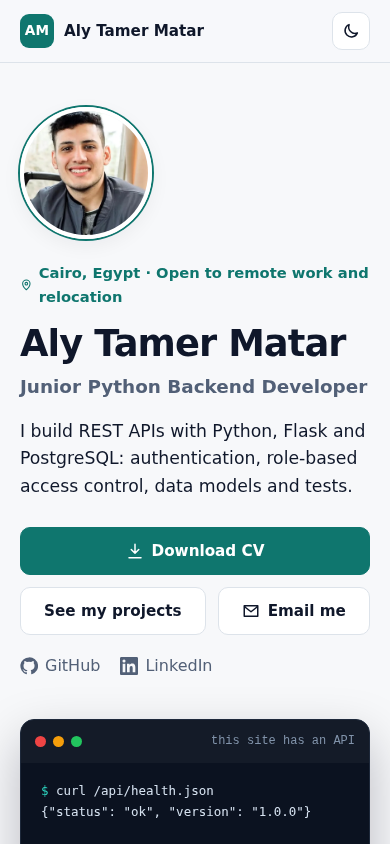

# Aly Tamer Matar · Portfolio

[](https://github.com/alymatar/portfolio/actions/workflows/ci.yml)

**Live: https://alymatar.github.io/**

My personal portfolio site, built as a small **FastAPI** app. I'm a junior Python backend developer, so instead of a static page I made the portfolio itself a backend project: server-rendered pages with **Jinja2**, a small **JSON API**, content validated with **Pydantic**, **pytest** tests, a **Docker** image and **GitHub Actions** CI.

| Light | Dark | Mobile |
| --- | --- | --- |
|  |  |  |

## Features

- Server-rendered pages (Jinja2 templates) with plain, responsive CSS and no frontend framework
- Light and dark theme: follows your system setting, with a toggle in the header
- All text lives in one file, `content.yaml`, validated with Pydantic when the app loads it
- JSON API:
  - `GET /api/health`: health check (used by Docker and CI)
  - `GET /api/projects`: all projects
  - `GET /api/projects/{slug}`: one project
  - The same endpoints also answer with a `.json` suffix (`/api/projects.json`), which is how the static live site serves them
  - Interactive API docs at `/api/docs`
- "Download CV" button serving the PDF from `app/static/`
- HTML 404 page for browsers, JSON errors for the API
- Docker image on `python:3.12-slim`, running as a non-root user, with a health check
- CI on every push: runs the tests, builds the Docker image and smoke-tests the running container

## Run with Docker

You need [Docker](https://docs.docker.com/get-docker/) with Docker Compose.

```bash
git clone https://github.com/alymatar/portfolio.git
cd portfolio
docker compose up --build
```

Open http://localhost:8000. Stop it with `Ctrl+C` (or `docker compose down` if you ran it with `-d`).

Without Compose:

```bash
docker build -t aly-portfolio .
docker run --rm -p 8000:8000 aly-portfolio
```

## Run without Docker

Requires Python 3.10 or newer (3.12 recommended).

```bash
git clone https://github.com/alymatar/portfolio.git
cd portfolio
python -m venv .venv
source .venv/bin/activate          # Windows: .venv\Scripts\activate
pip install -r requirements-dev.txt
uvicorn app.main:app --reload
```

Open http://localhost:8000. With `--reload`, changes to the code and templates show up on refresh.

## Run the tests

```bash
pip install -r requirements-dev.txt
pytest -v
```

The tests check that the home page and its sections render, every project appears, the profile and graduation photos and the CV are served, the API returns the projects, the health check works, and unknown pages return 404.

## Edit the content

Everything on the page comes from **`content.yaml`**: name, headline, About, skills, projects, experience, education, languages and contact links. Edit the text there; no code changes needed.

- Content is loaded once when the app starts, so **restart** the app after editing (`docker compose up --build`, or just save with `uvicorn --reload` running).
- To add a project, copy one of the entries under `projects:`. `status` is `public` (shows a "View code" button when `repo_url` is set) or `private` (client work, shows `note`).
- The photo is `app/static/img/aly-matar.webp` (with a `.jpg` fallback); replace both files to change it.
- The graduation photo in Education is `app/static/img/aly-graduation.webp` (with a `.jpg` fallback); its paths and alt text are under `education[].photo` in `content.yaml`.
- The CV is `app/static/Aly_Matar_CV.pdf`; replace the file to update it.
- If the YAML is invalid or a required field is missing, the app tells you which field on startup.

You can also point the app at another content file: `CONTENT_PATH=/path/to/content.yaml uvicorn app.main:app`.

## Live site

The live site at https://alymatar.github.io/ is a static snapshot of this app, hosted on GitHub Pages from the [alymatar.github.io](https://github.com/alymatar/alymatar.github.io) repo. The export script renders the real FastAPI pages with its test client and writes the JSON API out as files:

```bash
python scripts/export_static.py   # writes dist/
```

`dist/` holds `index.html`, `404.html`, an empty `.nojekyll`, the static assets and the API as files: `api/health.json`, `api/projects.json` and `api/projects/{slug}.json`. `/api/docs/` is a Swagger UI page reading the exported `api/openapi.json`, whose paths point at those files. The link-preview tags (`og:image`, `og:url`) use `site.url` and `site.image` from `content.yaml`.

To update the live site: run the export, copy the contents of `dist/` to the root of the `alymatar.github.io` repo and push to `main`.

## Project structure

```text
portfolio/
├── app/
│   ├── main.py              # FastAPI app: page routes, JSON API, 404 handling
│   ├── content.py           # Pydantic models + loader for content.yaml
│   ├── templates/
│   │   ├── base.html        # layout: header, theme toggle, footer
│   │   ├── index.html       # the portfolio page
│   │   ├── 404.html
│   │   └── _icons.html      # inline SVG icons
│   └── static/
│       ├── css/style.css    # all styles, light and dark theme
│       ├── js/theme.js      # theme toggle (the only JavaScript)
│       ├── img/             # profile and graduation photos
│       ├── favicon.svg
│       └── Aly_Matar_CV.pdf
├── scripts/export_static.py # builds the static snapshot for GitHub Pages
├── tests/test_app.py        # pytest tests
├── docs/                    # screenshots for this README
├── content.yaml             # all site text: edit this
├── Dockerfile
├── docker-compose.yml
├── requirements.txt         # runtime dependencies
├── requirements-dev.txt     # + pytest and httpx for tests
├── .github/workflows/ci.yml # tests + Docker build on every push
└── LICENSE                  # MIT
```

## Tech stack

Python 3.12 · FastAPI · Jinja2 · Pydantic · Uvicorn · PyYAML · pytest · Docker · GitHub Actions

## Contact

- Email: [matterali130@gmail.com](mailto:matterali130@gmail.com)
- LinkedIn: [linkedin.com/in/alymatar](https://www.linkedin.com/in/alymatar)
- GitHub: [github.com/alymatar](https://github.com/alymatar)

## License

[MIT](LICENSE)
